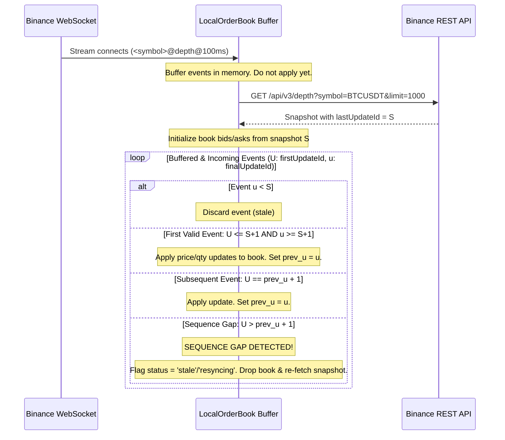
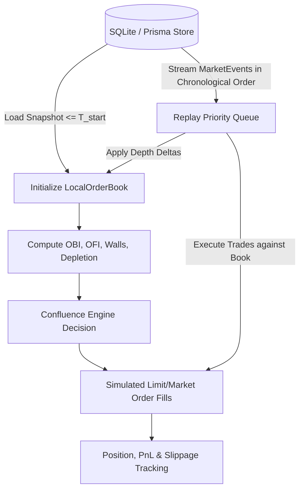

# Order Flow + Market Structure + Liquidity Intelligence System
## Architectural Specification & Quantitative Blueprint

**Status:** Proposed Architecture & Engineering Specification  
**Target Environment:** Pine TS Workbench (`pine-ts-workbench`), Binance Spot (BTC/ETH/SOL/BNB-USDT) & USD-M Futures (USDT/USDC pairs), DhanHQ equities/derivatives  
**Architectural Scope:** High-frequency order book dynamics, Level 2/3 tape analytics, smart money market structure, and hybrid multi-factor confluence trading intelligence  

---

## 1. Executive Summary & Core Philosophy

Market prices do not move simply because an indicator crosses a threshold; price moves because of supply and demand imbalances at specific price levels. Most retail indicators process historical OHLCV data after the trade has settled. An **Order Flow + Market Structure + Liquidity Intelligence System** operates at the interaction boundary of five foundational dimensions:

1. **Where liquidity exists:** Visible resting limit orders in the order book (Passive Liquidity).
2. **Where liquidity disappears:** Cancelled, repriced, or spoofed orders pulled from the book (Liquidity Withdrawal).
3. **Where transactions occur:** Market orders crossing the spread to consume resting depth (Aggressor Flow / Taker Tape).
4. **How price reacts at liquidity:** Absorption, exhaustion, rejection, depletion, or breakout.
5. **Where price moves next:** Liquidity sweeps, Fair Value Gaps (FVGs), high/low structural pivots, and liquidity vacuums.

```
+--------------------------------------------------------------------------------------------------+
|                                5 ANALYTICAL ENGINE PIPELINE                                      |
+--------------------------------------------------------------------------------------------------+
|  [Layer 1: Order Book Engine]                                                                    |
|    Binance @depth@100ms -> LocalOrderBook (Sequence-Valid, AVL/Sorted Map, Bucketed Depth)       |
+--------------------------------------------------------------------------------------------------+
|  [Layer 2: Tape & Aggressor Engine]                                                              |
|    Binance @trade/@aggTrade -> LiveTrade Aggressor Flow -> Delta, CVD & Footprint Matrix         |
+--------------------------------------------------------------------------------------------------+
|  [Layer 3: Microstructure Dynamics Engine]                                                       |
|    OBI (Top 5-50) | OFI (Cont-Stoikov) | Microprice | Persistence | Depletion | Icebergs        |
+--------------------------------------------------------------------------------------------------+
|  [Layer 4: Smart Money Market Structure Engine]                                                  |
|    Swing Pivots (HH/HL/LH/LL) | BOS / CHoCH | Fair Value Gaps (FVG) | Sweep / Stop Hunts        |
+--------------------------------------------------------------------------------------------------+
|  [Layer 5: Hybrid Confluence & Signal Engine]                                                    |
|    Multi-Factor Weighted Scoring (0-100) -> Setup Classification -> Confluence Execution Rules  |
+--------------------------------------------------------------------------------------------------+
```

---

## 2. Binance Stream Contracts & Local Book Synchronization

To guarantee 100% mathematical fidelity without corrupted state or false liquidity signals, the system enforces Binance's official local order book synchronization protocol.

### 2.1 WebSocket Stream Subscriptions
A multiplexed WebSocket stream subscribes to:
- `<symbol>@depth@100ms`: Incremental depth updates every 100ms.
- `<symbol>@trade` / `<symbol>@aggTrade`: Real-time transaction prints with buyer/seller aggressor flags (`m`).
- `<symbol>@bookTicker`: Best bid/ask price and quantity (sub-10ms top-of-book microsecond updates).
- `<symbol>@kline_1m`: Standard 1-minute OHLCV bar lifecycle.

### 2.2 Sequence-Valid Synchronization Lifecycle


### 2.3 Strict Zero-Quantity & Coverage Rules
- **Quantity Zero:** When an incoming update has quantity $Q = 0$, that price level is immediately removed from the active AVL tree / sorted index.
- **Coverage Clipping:** As price moves, depth updates beyond the active snapshot coverage boundaries ($\text{bidFloor} = \min(P_{\text{snapshotBids}})$, $\text{askCeiling} = \max(P_{\text{snapshotAsks}})$) are flagged as unverified to prevent false liquidity gaps or wall illusions.

---

## 3. Quantitative Mathematical Formulas

Every signal in the system is derived from deterministic mathematical formulations. No speculative heuristics or ungrounded values are used.

### Signal 1: Multi-Tier Order Book Imbalance (OBI)
OBI quantifies the relative concentration of resting buy vs. sell liquidity across depth tiers $K \in \{5, 10, 20, 50\}$:

$$OBI_K = \frac{\sum_{i=1}^K Q_{\text{bid}, i} - \sum_{i=1}^K Q_{\text{ask}, i}}{\sum_{i=1}^K Q_{\text{bid}, i} + \sum_{i=1}^K Q_{\text{ask}, i}} \quad \in [-1.0, +1.0]$$

- **Interpretation:**
  - $OBI \ge +0.60$: Extreme bid-side liquidity domination (strong support / passive buyer defense).
  - $+0.20 \le OBI < +0.60$: Moderate bid lean.
  - $-0.20 < OBI < +0.20$: Neutral / balanced book.
  - $-0.60 < OBI \le -0.20$: Moderate ask lean.
  - $OBI \le -0.60$: Extreme ask-side liquidity domination (heavy passive resistance).

### Signal 2: Order Flow Imbalance (OFI) — Cont-Kukanov-Stoikov Formulation
Based on Cont, Kukanov, and Stoikov (2014), OFI tracks dynamic shifts at the best bid and best ask between updates $n-1$ and $n$:

$$e_n = I_{\{P_{b,n} \ge P_{b,n-1}\}} Q_{b,n} - I_{\{P_{b,n} \le P_{b,n-1}\}} Q_{b,n-1} - I_{\{P_{a,n} \le P_{a,n-1}\}} Q_{a,n} + I_{\{P_{a,n} \ge P_{a,n-1}\}} Q_{a,n-1}$$

Where:
- $I_{\{\cdot\}}$ is the indicator function ($1$ if condition is met, $0$ otherwise).
- $P_{b,n}, Q_{b,n}$ are the best bid price and quantity at step $n$.
- $P_{a,n}, Q_{a,n}$ are the best ask price and quantity at step $n$.
- **Cumulative OFI:** $\text{CumOFI}_t = \sum_{k=1}^t e_k$. Divergence between price and $\text{CumOFI}$ signals imminent mean-reversion or absorption.

### Signal 3: Microprice (Queue-Weighted Midpoint)
The standard midpoint $P_{\text{mid}} = (P_a + P_b)/2$ ignores queue size. The Microprice reflects instantaneous fair value adjusted for top-tier bid/ask queue imbalance:

$$P_{\text{micro}} = \frac{Q_{\text{bid}, 1} \cdot P_{\text{ask}, 1} + Q_{\text{ask}, 1} \cdot P_{\text{bid}, 1}}{Q_{\text{bid}, 1} + Q_{\text{ask}, 1}}$$

- If $P_{\text{micro}} > P_{\text{mid}}$, aggressive buying pressure is poised to lift the ask.
- If $P_{\text{micro}} < P_{\text{mid}}$, heavy ask volume is poised to hit the bid.

### Signal 4: Liquidity Wall Detection & Relative Strength (RS)
A price level $L$ qualifies as a Significant Liquidity Wall when its notional value significantly exceeds normal book depth:

$$\text{Notional}(L) = P(L) \times Q(L)$$

$$\text{RS}(L) = \frac{\text{Notional}(L)}{\text{Median}\left(\left\{\text{Notional}(b) : b \in \mathcal{B}_{\text{depth}}, \text{last } 60\text{s}\right\}\right)}$$

- **Thresholds:**
  - $\text{RS}(L) \ge 3.0$: Tier-1 Institutional Liquidity Wall ("Big Buyer" / "Big Seller").
  - $2.0 \le \text{RS}(L) < 3.0$: Tier-2 Significant Depth Node.
  - $\text{RS}(L) < 2.0$: Ordinary order book noise.

### Signal 5: Liquidity Persistence Score & Spoof Detection
To distinguish legitimate institutional resting limit orders from manipulative spoof orders, we calculate temporal persistence over a rolling observation window $\tau$ (default: $\tau = 60\text{s}$):

$$\text{Persistence}(L, \tau) = \frac{\Delta t_{\text{present}}(L, \tau)}{\tau} \quad \in [0.0, 1.0]$$

$$\text{Spoofing Index}(L) = \begin{cases}
1.0 & \text{if } \text{Persistence}(L) < 0.25 \text{ and } \Delta Q_{\text{pulled}} \ge 0.80 \cdot Q_{\text{peak}} \text{ when } |P_{\text{last}} - P_L| \le 3 \text{ ticks} \\
0.0 & \text{otherwise}
\end{cases}$$

Orders with $\text{Persistence} \ge 0.75$ represent committed limit orders; orders pulled as price approaches are classified as spoofed.

### Signal 6: Liquidity Pulling & Addition Velocity
Tracks the rate of resting volume changes not caused by executed trades:

$$\text{PullVelocity}(L, \Delta t) = \frac{Q_{\text{pulled}}(L, \Delta t)}{\Delta t} \quad \left[\frac{\text{contracts}}{\text{sec}}\right]$$

$$\text{AddVelocity}(L, \Delta t) = \frac{Q_{\text{added}}(L, \Delta t)}{\Delta t} \quad \left[\frac{\text{contracts}}{\text{sec}}\right]$$

Where $Q_{\text{pulled}}$ and $Q_{\text{added}}$ are computed via `level-activity.ts` by reconciling depth deltas with executed taker trades in the identical time slice.

### Signal 7: Aggressor Volume & Cumulative Volume Delta (CVD)
Every trade is classified by aggressor side using the Binance taker flag `m`:
- $m = \text{false} \implies \text{Buyer is Maker, Seller is Taker} \implies \text{Aggressor Sell } (V_{\text{sell}} = q)$
- $m = \text{true} \implies \text{Buyer is Taker, Seller is Maker} \implies \text{Aggressor Buy } (V_{\text{buy}} = q)$

$$\Delta_{\text{bar}} = \sum V_{\text{buy}} - \sum V_{\text{sell}}$$

$$\text{CVD}_t = \text{CVD}_{t-1} + \Delta_{\text{bar}, t}$$

### Signal 8: Absorption Detection
Absorption occurs when aggressive market orders fail to push price through a level due to massive passive liquidity reloading:

$$\text{AbsorptionRatio}(L) = \frac{V_{\text{aggressor}}(L)}{|\Delta P| + \text{tickSize}}$$

$$\text{Absorption Condition} = \begin{cases}
\text{Bullish Absorption}: & V_{\text{sell taker}}(L) \ge 3 \times \overline{V}_{\text{bar}} \text{ and } \Delta P_{\text{bar}} \ge 0 \text{ and } P_{\text{close}} > P_L \\
\text{Bearish Absorption}: & V_{\text{buy taker}}(L) \ge 3 \times \overline{V}_{\text{bar}} \text{ and } \Delta P_{\text{bar}} \le 0 \text{ and } P_{\text{close}} < P_L
\end{cases}$$

### Signal 9: Liquidity Depletion / Wall Consumption Velocity
The velocity at which aggressive takers chew through a resting limit wall:

$$v_{\text{depletion}}(L) = \frac{\sum_{\tau} V_{\text{taker}}(L)}{Q_{\text{initial}}(L)}$$

- If $v_{\text{depletion}} > 0.80$ within $t < 2\text{s}$ and the wall does not replenish, trigger **Breakout Depletion**.
- If $v_{\text{depletion}} > 1.20$ and the level holds, trigger **Hidden Iceberg Absorption**.

### Signal 10: Iceberg / Hidden Liquidity Inference
A native iceberg order continuously replenishes its visible display quantity $Q_{\text{vis}}$ upon execution:

$$\text{IcebergMetric}(L) = \frac{\sum_{\text{window}} V_{\text{executed}}(L)}{\max(Q_{\text{vis, peak}}(L), Q_{\text{vis, current}}(L))}$$

- **Iceberg Inferred:** When $\text{IcebergMetric}(L) \ge 2.5$ and the level has been touched $\ge 3$ times without price breaking through by $\ge 1$ tick.

### Signal 11: Liquidity Vacuum Index (LVI)
A liquidity vacuum occurs when resting depth suddenly evaporates immediately ahead of price:

$$\text{DepthDensity}(P_0, \pm k) = \sum_{j=1}^k Q(P_0 \pm j \cdot \text{tick})$$

$$\text{LVI}(k) = \frac{\text{DepthDensity}(P_{\text{mid}}, k)}{\text{RollingMedian}\left(\text{DepthDensity}(k), 300\text{s}\right)}$$

- $\text{LVI} \le 0.20$: Liquidity Vacuum alert. Price is susceptible to high slippage and rapid acceleration into the next significant liquidity wall.

### Signal 12: Liquidity Sweeps / Stop Hunts & SMR
A Liquidity Sweep occurs when price breaches a key structural high or low, consumes stop-loss liquidity, and immediately reverses:

$$\text{Sweep Condition} = \begin{cases}
\text{Bearish Sweep}: & P_{\text{high}} > \text{SwingHigh} \text{ by } [1, 10] \text{ ticks}, \Delta_{\text{extreme}} \gg 0, \text{ and } P_{\text{close}} < \text{SwingHigh} \\
\text{Bullish Sweep}: & P_{\text{low}} < \text{SwingLow} \text{ by } [1, 10] \text{ ticks}, \Delta_{\text{extreme}} \ll 0, \text{ and } P_{\text{close}} > \text{SwingLow}
\end{cases}$$

---

## 4. Market Structure & Order Flow Confluence Engine

The real edge is the **interaction** between market structure (SMC) and micro-order flow. 

### 4.1 Structural Matrix Elements
1. **Swing Pivots:** Fractal Higher Highs (HH), Higher Lows (HL), Lower Highs (LH), Lower Lows (LL) calculated with dynamic bar lookback $N \in [3, 10]$.
2. **Break of Structure (BOS):** Candle body close violating the previous swing high/low in the direction of the dominant trend.
3. **Change of Character (CHoCH):** First structural break against the dominant trend indicating trend exhaustion.
4. **Fair Value Gaps (FVG):**
   - Bullish FVG: $\text{Low}_{\text{bar } t} > \text{High}_{\text{bar } t-2}$. Unmitigated gap zone $= [\text{High}_{t-2}, \text{Low}_t]$.
   - Bearish FVG: $\text{High}_{\text{bar } t} < \text{Low}_{\text{bar } t-2}$. Unmitigated gap zone $= [\text{High}_t, \text{Low}_{t-2}]$.

### 4.2 Multi-Factor Confluence Scoring Algorithm
Every candidate trade setup is evaluated across 5 weighted dimensions to generate a composite Confluence Score $\mathcal{S} \in [0, 100]$:

| Factor | Weight | Condition & Metric Thresholds |
|---|---|---|
| **1. Market Structure** | **25%** | Price mitigates an active unmitigated FVG or touches a structural HL/LH pivot (+20%). Active CHoCH confirms reversal (+5%). |
| **2. Resting Liquidity** | **20%** | Confluence level hosts a Tier-1 Liquidity Wall ($\text{RS} \ge 3.0$) with $\text{Persistence} \ge 0.70$ (+20%). Moderate wall $\text{RS} \ge 2.0$ (+10%). |
| **3. Tape Aggression & Absorption**| **25%** | High taker volume absorbed at the level with $\text{AbsorptionRatio} \ge 3.0$ (+15%). CVD divergence against price direction (+10%). |
| **4. Order Book Imbalance (OBI/OFI)**| **15%** | Multi-tier $OBI_{10} \ge +0.40$ (for long) or $\le -0.40$ (for short) (+10%). Positive Cont-Stoikov OFI slope (+5%). |
| **5. Liquidity Sweep Confirmation** | **15%** | Preceding stop hunt sweep of the local swing level with rapid reclaim (+15%). |

$$\mathcal{S}_{\text{composite}} = \sum_{i=1}^5 w_i \cdot s_i$$

### 4.3 Setup Classification & Action Matrix
- **Tier-1 Prime Confluence ($\mathcal{S} \ge 80$):**
  - *Full Position Size.* Enter on reclaim of level. Stop-loss placed strictly behind the absorbed wall / sweep wick. Take-profit target set to the opposing liquidity wall or unmitigated FVG.
- **Tier-2 Quality Confluence ($65 \le \mathcal{S} < 80$):**
  - *Half Position Size.* Enter with confirmation candle close.
- **Sub-Threshold ($\mathcal{S} < 65$):**
  - *No Trade.* Filtered out as low-probability chop.

---

## 5. Event Contracts & Persistence Architecture

The persistence layer captures market data continuously in a background server collector (running Bun / SQLite via Prisma), enabling offline retention, historic backtesting, and millisecond-accurate event replay.

### 5.1 Prisma Schema Models
Existing models in `prisma/schema.prisma` are reused and extended:

```prisma
// High-frequency depth deltas, trades, and gaps
model MarketEvent {
  id            Int     @id @default(autoincrement())
  symbol        String
  kind          String  // "depth" | "trade" | "gap" | "ticker"
  seq           BigInt
  exchangeTime  Float?
  receivedAt    Float
  payload       String  // Compact JSON string
  schemaVersion Int     @default(1)

  @@unique([symbol, kind, seq])
  @@index([symbol, receivedAt])
}

// 60-second full order-book state snapshots for fast-seek replay
model BookSnapshot {
  id           Int    @id @default(autoincrement())
  symbol       String
  capturedAt   Float
  lastUpdateId BigInt
  bids         String  // JSON [[price, qty], ...]
  asks         String  // JSON [[price, qty], ...]
  coverage     String  // JSON { bidFloor, askCeiling }

  @@index([symbol, capturedAt])
}

// Historical state transitions of significant liquidity walls
model WallTransition {
  id              Int    @id @default(autoincrement())
  wallId          String
  symbol          String
  side            String // "bid" | "ask"
  price           Float
  kind            String // "detected" | "increased" | "reduced" | "removed" | "pulled"
  notional        Float
  at              Float
  detectorVersion String

  @@index([symbol, at])
}

// Resolved interactions (Turned, Broke, Pulled, Consumed)
model LiquidityInteraction {
  id                Int    @id @default(autoincrement())
  wallId            String
  symbol            String
  side              String
  levelPrice        Float
  detectedAt        Float
  startAt           Float
  resolvedAt        Float?
  outcome           String // "TURNED" | "BROKE" | "PULLED_BEFORE_TOUCH" | "CONSUMED"
  mfePct            Float?
  maePct            Float?
  classifierVersion String

  @@unique([wallId, startAt, classifierVersion])
  @@index([symbol, startAt])
}
```

### 5.2 Compaction & Retention Policy
- Raw `MarketEvent` rows older than 3 days are purged by a daily cron job.
- `BookSnapshot` rows are retained for 14 days.
- `WallTransition` and `LiquidityInteraction` analytics records are retained permanently for institutional outcome statistical modeling.

---

## 6. Chart Presentation & Visual Experience

Visual clarity is paramount. Rather than cluttering the chart with disjointed indicators, the system integrates signals directly into the chart canvas via lightweight-charts custom primitives and an executive HUD.

```
+---------------------------------------------------------------------------------------------------+
|  [Pine TS Workbench Chart Pane]                                                                    |
|                                                                                                   |
|   Price |                                                            +-------------------------+  |
|         |                                                            | CONFLUENCE HUD          |  |
|   73.00 |                                              [Ask Wall] ◯  | Setup: BULL ABSORPTION  |  |
|         |                  [Bearish FVG]                             | Score: 87/100 (Prime)   |  |
|   72.85 |             +---------------------+                        | OBI(10): +0.64          |  |
|         |             |                     |                        | Target: 73.00 Wall      |  |
|   72.70 |             +---------------------+                        | Stop: 72.64             |  |
|         |                 |   |                                      +-------------------------+  |
|   72.65 |                 | █ | ◀ Dynamic Bubbles                                                 |
|         |                 | █ |   (Size = Notional,                                               |
|   72.50 |    [Bull FVG]   | █ |    Color = Held/Pull)                                             |
|         |  +------------+ | █ |                                                                   |
|   72.40 |  |  Sweep Wick|─┴─┴─ [Bid Wall 8.4k] ◯                                                  |
|         |  +------------+                                                                         |
|---------+-----------------------------------------------------------------------------------------|
|  DOM    | [Bids: 8.4k ██████████]  72.40  [ 420 sold | 3.2k bought | Big Buyer (held) ]           |
|  Ladder | [Bids: 1.2k ██        ]  72.45  [  50 sold |  120 bought                    ]           |
|         | [                      ]  72.50  [   Last Price: 72.50 ◀                        ]           |
|         | [Asks: 2.1k   ████    ]  72.55  [ 1.8k sold |  200 bought | 800 pulled       ]           |
+---------------------------------------------------------------------------------------------------+
```

### 6.1 Visual Primitives
1. **Dynamic Liquidity Bubbles (`dom-bubbles-primitive.ts`):**
   - Plotted at price ladder levels.
   - Circle radius $R \propto \log_{10}(\text{Notional})$.
   - Color coding:
     - Emerald green ($\text{Persistence} \ge 0.70$, resting bid).
     - Crimson red ($\text{Persistence} \ge 0.70$, resting ask).
     - Amber pulse: Wall currently under active taker attack ($v_{\text{depletion}} > 0.50$).
     - Dim grey hatching: Pulled/cancelled before price arrival.
2. **Liquidity Heatmap (`liquidity-heatmap-primitive.ts`):**
   - Time-series background bands of order book depth (1s resolution).
   - Intensity mapped via logarithmic scale clipped at the 99th percentile.
3. **Footprint Matrix (`footprint-primitive.ts`):**
   - Rendered inside candle bodies when zoomed in ($\text{barWidth} \ge 24\text{px}$).
   - Displays Bid $\times$ Ask volume or Delta volume per price bucket, highlighting absorption imbalance nodes in bright cyan.
4. **Market Structure Annotations:**
   - Shaded translucent boxes for active Fair Value Gaps (`draw.box`).
   - Swing pivot labels (`HL`, `HH`, `LH`, `LL`) and dotted horizontal levels for Break of Structure / Liquidity Sweeps (`draw.line`).
5. **Executive Confluence HUD (`draw.table`):**
   - Glassmorphism top-right HUD table showing real-time OBI, OFI, nearest bid/ask wall proximity, active regime, and composite confluence score.

---

## 7. Strategy Backtesting & Replay Engine

Testing high-frequency microstructure strategies on OHLC bars leads to severe backtesting distortion and fictitious fills. The workbench implements an **Event-Driven Deterministic Replay Engine**:



### 7.1 Realistic Fill Simulation
- **Passive Limit Orders:** A simulated limit order is placed at the back of the queue at price $P_L$. It fills only after the cumulative trade volume at $P_L$ exceeds the pre-existing depth ahead of it in the queue ($V_{\text{trades}}(P_L) \ge Q_{\text{ahead}} + Q_{\text{order}}$).
- **Market Orders:** Executed by sweeping through resting bids/asks in the replayed `LocalOrderBook`, accurately simulating realistic market slippage.

---

## 8. Operational Safeguards & Failure Modes

| Risk / Failure Mode | Root Cause | Built-in Operational Safeguard |
|---|---|---|
| **WebSocket Disconnect / Silent Freeze** | Cloudflare drops, ISP hang | Watchdog timer: If no depth message is received for 5,000ms, immediately flag status as `stale`, terminate socket, and trigger exponential backoff reconnect (1s, 2s, 4s, max 16s). |
| **Sequence Gap / Desynchronization** | Dropped UDP packet or socket buffer overflow | If $U > \text{prev\_u} + 1$, reject packet, set state to `syncing`, clear order book, and immediately trigger REST snapshot re-synchronization. |
| **Memory Leak from High Event Volume** | Unbounded event logging in long sessions | Fixed-capacity ring buffers: Depth history capped at 300 slices (5 minutes). Order book pruning of levels beyond $\pm 10\%$ from mid-price. |
| **UI Main-Thread Stutter / Frame Drops** | React re-rendering on 100ms depth bursts | Complete separation: React components never subscribe directly to raw depth events. Visual primitives update via Canvas 2D/WebGL `requestAnimationFrame` batched loops. React HUD throttled to 4Hz (250ms). |
| **Coverage Floor/Ceiling Illusion** | Price travels outside initial snapshot bounds | `clippedByCoverage` flag: Levels outside verified boundaries are drawn with diagonal hatch lines and excluded from wall detection algorithms. |

---

## 9. Phased Implementation Roadmap

### Phase 1: Pure Mathematical Foundations & Multi-Tier Metrics
- **Scope:** Implement pure, fully tested analytical utilities in `src/lib/`.
- **Files:**
  - `src/lib/order-book-metrics.ts`: Multi-tier OBI ($K \in \{5, 10, 20, 50\}$), Cont-Stoikov OFI, Microprice.
  - `src/lib/liquidity-persistence.ts`: Time-at-level persistence score, spoofing index, and pull/add velocities.
- **Verification:** Unit tests verifying exact formulas against synthetic order-book matrices.

### Phase 2: Microstructure Detectors (Absorption, Depletion & Sweeps)
- **Scope:** Event-driven detection of institutional order-flow patterns.
- **Files:**
  - `src/lib/absorption-detector.ts`: Volume vs. price progress, delta absorption ratio, iceberg inference heuristic.
  - `src/lib/sweep-detector.ts`: High-water mark breaches with rapid reclaim and delta divergence.
- **Verification:** Unit tests with replayed trade vectors confirming zero false-positive absorptions during ordinary trending bars.

### Phase 3: SMC Structure & Hybrid Confluence Engine
- **Scope:** Combining price action (FVG, Swing Pivots) with micro-order flow.
- **Files:**
  - `src/lib/market-structure.ts`: Lightweight, pure FVG and swing pivot tracker.
  - `src/lib/order-flow-confluence.ts`: 5-factor weighted scoring algorithm, signal classifier.
  - `src/lib/scripts/order-flow-intelligence-engine.ts`: Ready-to-run Pine TS indicator and strategy script with glassmorphism HUD.
- **Verification:** Execution in Pine TS runtime verifying deterministic signals on BTCUSDT and ETHUSDT.

### Phase 4: Integrated Chart Canvas Primitives & Visual Upgrades
- **Scope:** Visual rendering of dynamic liquidity bubbles and HUD dashboard.
- **Files:**
  - `src/components/chart/dom-bubbles-primitive.ts`: Canvas-based dynamic liquidity bubbles on the DOM ladder.
  - `src/components/chart/confluence-hud-overlay.tsx`: Interactive real-time metrics HUD.
- **Verification:** Visual verification on port 3417; zero layout shifts or frame drops during rapid depth updates.

### Phase 5: Replay Parity & End-to-End Hardening
- **Scope:** Historical replay verification and collector soak testing.
- **Verification:** Parity diff: Recorded live live-stream output compared against historical replay of the identical timestamp range; results must match to within 0.0001%.
